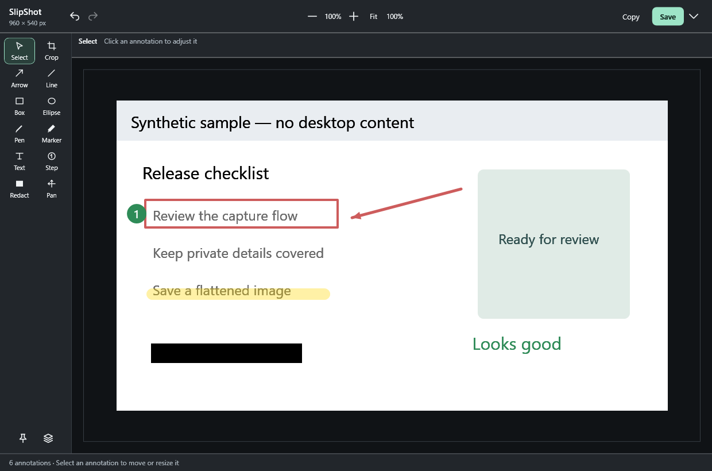
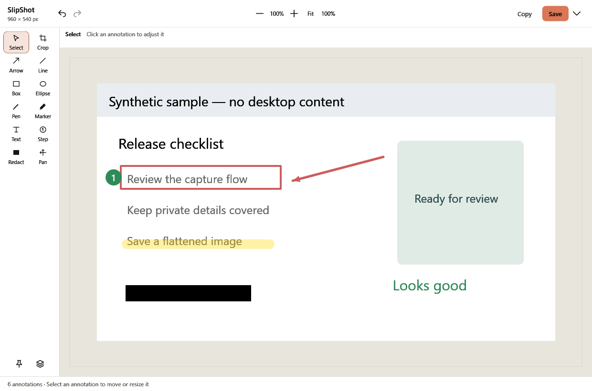
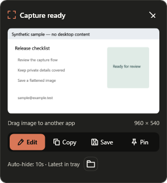

<picture>
  <source media="(prefers-color-scheme: dark)" srcset="docs/branding/slipshot-dark.svg" />
  
</picture>

[](https://github.com/adityashelke04/SlipShot/actions/workflows/windows.yml)
[](LICENSE)

Previously developed under the working name LeftShot. Historical audit records and older releases retain that name; current code and builds use SlipShot.

A small, local-only Windows screenshot editor. Capture a region, open the bottom-left preview, annotate, and copy or save a flattened image.

**0.2.8-preview.1 — Frame-S identity and a consistent light/dark interface.** Synthetic tests do not establish production readiness. SlipShot is a provisional name, without a trademark availability claim. MIT license for original code. No BridgeShot source, binaries, branding or artwork is included.

## App preview

The real WPF interface, rendered with generated demo content only. **No personal screenshots or desktop content are used.** [How these images were made](docs/images/README.md).



<details>
<summary>Light appearance</summary>



</details>



## Run the portable preview

Windows 10 version 2004 or newer / Windows 11, **x64**, with the **.NET 8 Windows Desktop Runtime**. Keep all files in the portable folder together and run `SlipShot.exe`. It starts in the notification area, without an editor or capture overlay appearing automatically. Default capture shortcut: **Ctrl+Alt+S**. The tray also provides capture, recent-image access, settings and exit. Windows may hide the tray icon in its overflow menu.

Build output: `artifacts/portable/SlipShot.exe`. Organized release: `artifacts/releases/0.2.8-preview.1/win-x64/SlipShot.exe`. Exit the previous version from its tray menu before running the new version; unsaved editors must be resolved normally. It is unsigned; Windows reputation warnings are possible. Do not disable Windows security. No installer, service, startup registration or updater is supplied.

All preferences live in `data/settings.json` beside the executable. Put the portable folder in a location you can write. There is no screenshot history or automatic saving on capture. **Save** writes a PNG directly to **F:\SlipShot Captures** on this installation, without a dialog. It then becomes disabled **Saved**. Repeated Save/Ctrl+S for the same capture version does not write another file, including after reopening its editor. An edit enables Save again and exports a new version while preserving the previous file. Undo/redo recognizes versions already saved. Change **Quick-save folder** in Settings. **Save a copy as…** (the arrow beside Save or Ctrl+Shift+S) deliberately creates another copy or chooses JPEG/a different filename. Failed saves keep edits and allow retry; missing files are checked on reopening, activation, preview entry and Save rather than continuously polled. No existing captures are deleted by this fix.

The default follows the local drive hosting the app (`<drive>:\SlipShot Captures`), so it remains stable across versioned installs. A network-hosted portable app instead defaults to local application data. Deliberately dragging creates a temporary flattened PNG in `data/drag-out` beside the app. No cloud location is selected automatically; a custom destination is explicitly user-selected.

The small **folder box beside “Latest in tray”** opens the configured captures folder in Windows File Explorer. Its tooltip/accessibility name identifies Open file location. It works before/after saving and creates only an empty folder if needed. It does not save a screenshot or select a particular exported file. If you change Quick-save folder in Settings, this action follows that folder. Errors stay inside the preview. Edit/Copy/Save/Pin remain the primary single-row actions.

The app now embeds an original Frame-S icon in the executable, editor windows and tray, at16–256px. Its exact palette is orange`#D97757` and dark`#141413`; normal UI accents follow the same orange with contrast-safe text/focus. [Three generated logo concepts, SVG masters and audits](docs/branding/README.md) are retained for comparison. No Anthropic/Claude logo is used and no affiliation is implied.

## Everyday flow

1. Place the pointer on the desired monitor. Press Ctrl+Alt+S or choose **Capture region** from the tray.
2. Drag in any direction within that monitor. Release to capture; Escape cancels. Cross-monitor selection is deliberately constrained. Keyboard alternative: Space sets the center anchor, arrows adjust the end point, Shift moves 10 pixels, Enter captures.
3. The preview appears at the **bottom-left of that monitor's work area**. Click the image to edit, or hold and drag it into an app that accepts files/images. Edit, Copy, Save and Pin remain available. It auto-hides after10seconds by default. Hover adds at most20additional seconds; a parked pointer or stale focus cannot pin it forever. Genuine holds, drags and active copying pause it. Appearance does not activate the app. The tray gives keyboard access to the latest capture.
4. In the editor, use Crop, Arrow, Line, Rectangle, Ellipse, Pen, Highlight, Text, numbered Step or opaque Redact. Select objects from the canvas or Annotations panel, move them, drag a resize handle, or delete them. Text controls support content, font size and opaque color; rectangles and ellipses support fill.
5. Ctrl+Z undoes; Ctrl+Y / Ctrl+Shift+Z redoes. Ctrl+C copies the flattened image; Ctrl+S saves. These shortcuts yield to text/combo editing. Ctrl+wheel zooms; Fit fits without enlarging past100%; 100% maps one source pixel to one physical screen pixel. Middle-drag or Space+drag pans. Arrow keys nudge a selected object; Shift nudges 10 source pixels. Editing closes through Save / Discard / Cancel.

Drag handoff uses standard Windows FileDrop, Bitmap and PNG formats. A terminal may insert a file path, an agent composer may attach an image, and some targets reject drops entirely. Drag onto the image-attachment area when available. Windows may block drops into elevated apps; SlipShot does not elevate or bypass this. A path-only terminal target must keep the referenced file or save its own copy if it needs long-term access.

Accepted drag files survive app exit for late target reads. Owned files older than24hours are cleaned only on a later explicit drag; they are not guaranteed to disappear at24hours. Retention is capped at32files/256MiB; on capacity, use Copy or Save rather than silently evicting recent handoffs. Canceled/interrupted transfers delete their own temporary file where filesystem permissions allow. These temporary files contain only flattened exported pixels. Ordinary captures still create no file.

SlipShot is an open-source preview with `main` tracking `origin/main`. See [contributing](CONTRIBUTING.md), [security reporting](SECURITY.md), and [publishing notes](docs/PUBLISHING.md). Desktop acceptance remains ongoing; this is not a stable production release.

Only the newest capture is shown: a successful second capture replaces the first card and its actions. Older cards do not resurface on timeout. Canceling capture retains the prior card if it has not already expired. The latest capture remains in the tray until replaced, forgotten or exit. Dismissal never deletes saved files. Three editors and three pins are allowed, subject to the image-memory budget. **Forget in-memory previews** leaves editors and pins intact.

Capture alone does **not** change the clipboard unless you enable automatic copying in Settings. Press **Copy** and wait for **Copied · Ctrl+V to paste**, then paste into an image-aware destination. Copy publishes bitmap and PNG representations; an ordinary terminal may not accept image paste. New copy requests supersede pending older retries. Preview timing remains configurable from2to60seconds; passive grace is twice that setting. See [timeout and multi-capture review](docs/PREVIEW_REVIEW.md).

## Build and test with an SDK

Use a supported .NET 8 SDK for these commands. The [Windows CI build](https://github.com/adityashelke04/SlipShot/actions/workflows/windows.yml) verifies SDK restore/build and 134 serial synthetic tests. This development machine has the .NET 8.0.11 desktop runtime and no SDK; its separate fallback validation is described below. Use a currently serviced runtime patch on your machine; 8.0.11 is not current. .NET 8 support ends November 10, 2026; migrating the target is a follow-up before a long-lived public release. See [Microsoft's support policy](https://dotnet.microsoft.com/en-us/platform/support/policy/dotnet-core).

From PowerShell in this repository:

```powershell
. ./scripts/environment.ps1
dotnet restore SlipShot.sln --disable-parallel
dotnet build SlipShot.sln -c Release --no-restore -m:1 -p:UseSharedCompilation=false
New-Item -ItemType Directory -Force artifacts/tests | Out-Null
dotnet run --project tests/SlipShot.Tests -c Release --no-build -- --workers=0 --work=artifacts/tests --result=TestResult.xml
dotnet publish src/SlipShot -c Release --no-restore --self-contained false -o artifacts/sdk-portable -m:1 -p:UseSharedCompilation=false
# Only when you are ready for desktop interaction:
./artifacts/sdk-portable/SlipShot.exe
```

The tests use NUnitLite's maintained lightweight runner, so the test command is `dotnet run` above, not an empty `dotnet test` invocation. Test fixtures are synthetic and clipboard sinks are fake. The environment script redirects NuGet, CLI-home and temporary data into this repository, disables development CLI telemetry and lowers only its own shell/child-process priority. It does not change your global environment or other processes.

## Verified SDK-less build on this machine

The fallback uses the installed desktop runtime, a small Microsoft Roslyn compiler package, NUnit, Microsoft's apphost template and a build-only host-writing library. It compiles optimized x64 code with nullable warnings treated as errors; it is a useful local validation path, not a replacement for SDK validation on CI.

```powershell
. ./scripts/environment.ps1
python scripts/bootstrap-compiler.py
./scripts/build-fallback.ps1 -Test -VisualCheck
# Only when you are ready:
./artifacts/portable/SlipShot.exe
```

`-VisualCheck` renders synthetic editor content offscreen in software. It does not show windows, capture the desktop, register hotkeys or touch the real clipboard. Downloads and generated files remain inside this repository. The installed app has no networking code or development tool dependencies.

## Limits and privacy

- GDI still-image capture is SDR, without cursor inclusion. HDR colors may differ. Protected surfaces and exclusive fullscreen may return black/unavailable images. An all-black frame is rejected, including a legitimately all-black desktop. No hooks, injection, elevation, anti-cheat interaction or bypass is attempted.
- Capture exclusion is best effort; own visible windows are also hidden before capture and DWM is flushed. This is not a confidentiality guarantee against other tools. Those native behaviors require the checks in TESTING.md.
- Selection coordinates are physical pixels; editor coordinates are source pixels. Strokes scale with image zoom; resizing object geometry retains its stroke width. Resizing text changes font size. Exports use crop pixel dimensions at 96 DPI, without source metadata/layers/thumbnails.
- Redaction is opaque black and rendered last. Original pixels remain in the in-memory source and undo history until references are released. No forensic RAM erasure or OS clipboard-history deletion is promised. Pin copies are independently retained until closed.
- No telemetry, accounts, OCR, AI models, uploading, updater or background network requests. No screenshot/clipboard/window-title logging. Preferences contain no image data.
- CPU, working-set and gameplay impact have not been measured. Timers run only while a preview is alive. Idle targets are intentions pending measurement, not zero-impact claims.
- Full-monitor/foreground-window capture, OCR, persistent history and presentation export are intentionally absent. Pin is implemented. There are no controls for absent tools.

See [TESTING.md](TESTING.md), [ARCHITECTURE.md](ARCHITECTURE.md), [REFERENCE_NOTES.md](REFERENCE_NOTES.md), [DEPENDENCIES.md](DEPENDENCIES.md), and the three audit reports under `docs/`.
