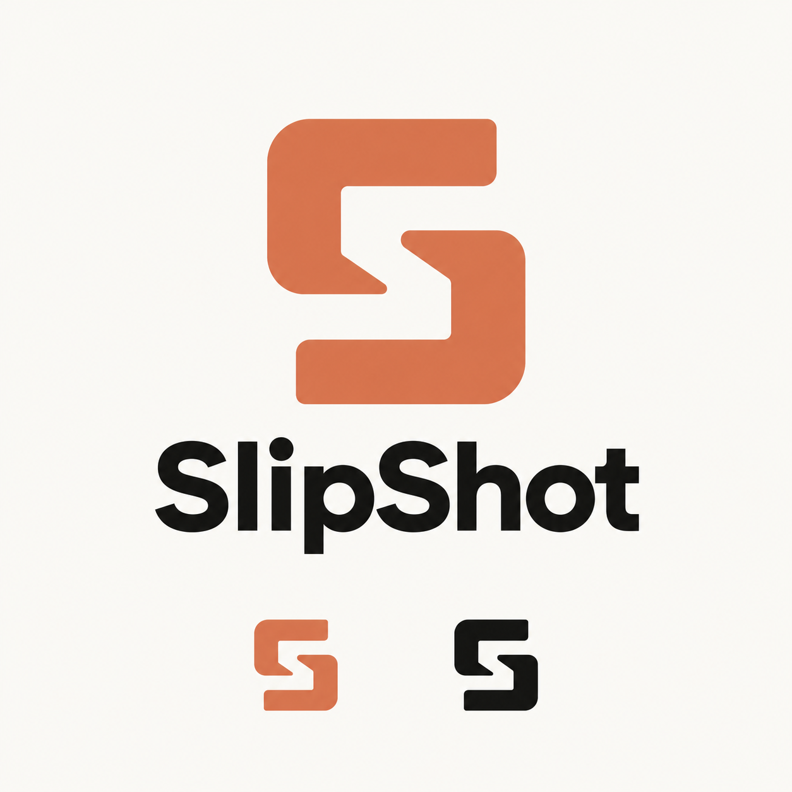
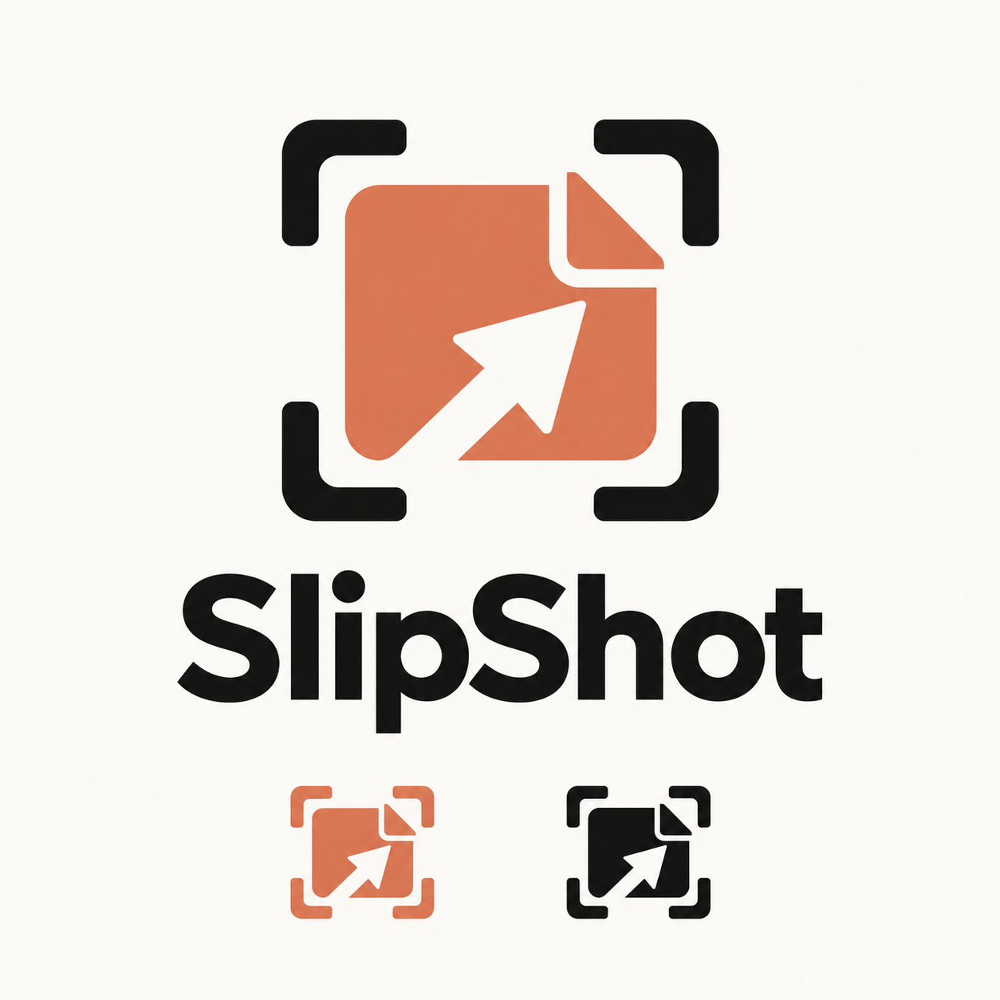
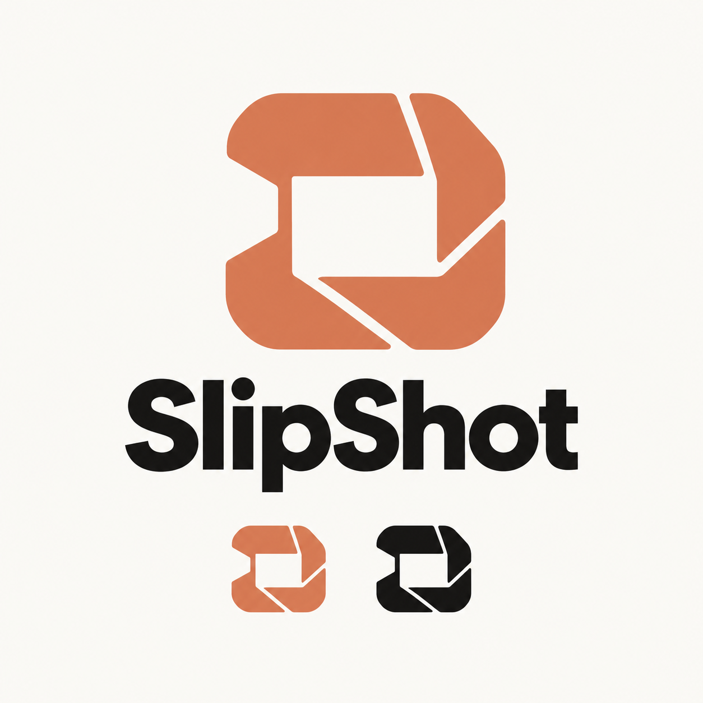

# SlipShot identity concepts

Three original concept boards were generated with ChatGPT's built-in image-generation tool on2026-10-31. Prompts contained only the product brief and palette; no user screenshots or personal content were supplied to generation. Boards are preserved unchanged. Canonical SVGs are simplified original geometric interpretations, not raster edits.

The requested colors are verified against [Anthropic's published brand-guidelines skill](https://github.com/anthropics/skills/blob/main/skills/brand-guidelines/SKILL.md): **orange#D97757**, **dark#141413**. Only the palette is inspiration. No Anthropic asterisk/wordmark, third-party icon pack or protected app asset is included. Naming/trademark clearance was not performed.

## 1. Frame-S — selected default

Two opposing capture brackets form an S. Best of these concepts for tray recognition because its wide masses and central channel survive small sizes. [Orange SVG](../../src/SlipShot/Assets/frame-s.svg) · [Dark SVG](../../src/SlipShot/Assets/frame-s-dark.svg).

## 2. Lifted Slip — descriptive alternative

A captured slip, folded corner and outward motion. Strongest literal capture/drag meaning, but its detail is less suitable for16px; retain it as an alternative for larger contexts. [Two-color SVG](../../src/SlipShot/Assets/lifted-slip.svg) · [Dark SVG](../../src/SlipShot/Assets/lifted-slip-dark.svg).

## 3. Open Shutter — abstract alternative

An open rectangular aperture with broad moving segments. More abstract and capture-oriented; ranked second for a compact app identity. [Orange SVG](../../src/SlipShot/Assets/open-shutter.svg) · [Dark SVG](../../src/SlipShot/Assets/open-shutter-dark.svg).

## Production and audit distinction

Generated boards have subtle tonal variation and are concept artwork, **not exact-color production files**. The SVG masters use literal exact hex fills. Production Frame-S ICO has transparent outer corners, exact flat interior colors and9sizes. WPF windows explicitly load the largest frame; the tray receives an owned32px icon; the executable includes native Windows icon resources. No generated raster wordmark/font is embedded in the app.

[Independent visual audit](LOGO_AUDIT.md) · [Asset/build specification](ASSETS.md) · [Final engineering and UX audit](FINAL_AUDIT.md).

All three masters were rendered at16/24/32/64px for comparison. The chosen app icon was additionally rendered at16/20/24/32/40/48/64/128/256px. Frame-S remains the recommendation; this is design judgment, not a user-study result or global-uniqueness claim. Native taskbar/cache appearance needs a normal restart and manual observation; no Windows icon cache was cleared.

Original board SHA256 values:

| Board | SHA256 |
|---|---|
| Frame-S | `09a0c42f4d751f10f3a9fdb677c301fad864de7ca75117d89e793709cff952af` |
| Lifted Slip | `6f160d98be8fa44f05facefcbd2319a6adbbe751c2c673dc4710e712eba275bc` |
| Open Shutter | `1a973f31f01495ec4633f08f1f3eea705984739fb70ee429c18707c5f24573b5` |
